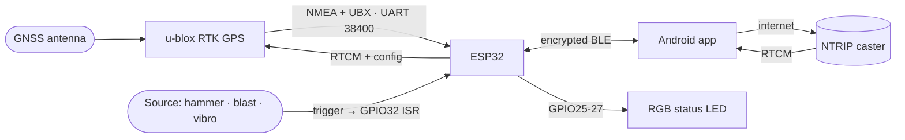

  

<h1 align="center">SmartSeismicSystem</h1>

<strong>Pinpoint the source. Own the future.</strong>

Centimeter-accurate RTK GPS + millisecond-precise (nanosecond-capable) seismic shot timing — on hardware and code built in-house.

  
  
  
  
  

---

## What it is

**A multipurpose seismic field system: RTK survey positioning _and_ a universal source trigger — in one phone-sized device.**

> **RTK GPS gives the _where_. The source trigger gives the _when_.**
> Every shot point is geolocated to the **centimeter** and timestamped to the **millisecond** — replacing bulky, expensive commercial _positioning **and** trigger_ gear with a phone + a matchbox-sized box.
>
> _Millisecond-precise today; the u-blox UBX-NAV-PVT time base is nanosecond-resolution, so the design is **nanosecond-capable** once a PPS input is added._

**Two jobs, one box:**

1. **Survey** — lay out & record source/receiver points at cm RTK accuracy (lines/stations, 5-point averaging, stakeout, QC, ITM/EPSG export).
2. **Trigger** — capture the exact instant energy enters the ground, geolocated + timestamped.

**Source-agnostic — that's the game.** The trigger fires on any **contact closure or trigger pulse**, so it works across essentially every seismic source:

- 🔨 **Hammer & plate** · weight-drop
- 💥 **Explosive shots / blasts** — blaster fire / shot-break
- 🚛 **Vibroseis** — mechanical _and_ hydraulic vibrators (time-break / start-of-sweep)
- ➕ …and anything else that closes a contact or emits a pulse (with simple signal interfacing)

### Under the hood

- 🛰️ **`firmware/`** — ESP32 + u-blox RTK-GPS: centimeter positioning, a GPIO32 falling-edge ISR shot trigger with millisecond UBX-NAV-PVT timestamps (nanosecond-resolution time base), RTCM relay over **encrypted** BLE, LittleFS waypoint/shot storage.
- 📱 **`app/`** — Expo SDK 56 / React Native: BLE link, NTRIP correction relay, live Leaflet map, survey + averaging, the **Shots** tab, stakeout, QC, and CSV/photo export in ITM / EPSG.

## Features

| | |
|---|---|
| 🎯 **Centimeter RTK** | u-blox multi-band + NTRIP corrections relayed phone → device |
| ⏱️ **Millisecond shots** (ns-capable) | any source — hammer / blast / vibroseis → ISR → UBX-NAV-PVT timestamp |
| 📡 **Survey** | line/station numbering, 5-point averaging, retake |
| 🗺️ **Live map** | Leaflet / OSM, offline tile cache, waypoint + shot layers |
| 🧭 **Stakeout** | navigate to planned points |
| ✅ **QC** | duplicate / no-fix / accuracy / station-gap checks |
| 📤 **Export** | CSV (ITM / EPSG), KML, photos; raw NMEA log |
| 🔊 **Field UX** | voice prompts + shot / waypoint sounds |

## Screenshots

  
  &nbsp;
  
  &nbsp;
  

Survey numbering &amp; stakeout · shot-trigger config (edge / debounce / apply-to-device) · device &amp; NTRIP caster setup

## Architecture

**Wiring (ESP32):**

| Pin | To | Notes |
|---|---|---|
| `GPIO16` / `GPIO17` | GPS TX / RX | UART1, 38400 8N1 |
| `GPIO25` / `26` / `27` | RGB LED R / G / B | status |
| `GPIO32` | hammer (plate → GND) | `INPUT_PULLUP`, falling-edge = shot |

### How to wire it

## Roadmap

**Universal trigger**

- 💥 **Any source, one box** — opto-isolated inputs so the same unit fires on blaster fire / shot-break, vibroseis time-break, weight-drop, or a hammer/plate contact.
- 🎯 **Sub-millisecond timing** — wire the receiver's PPS pin to push shot times from millisecond toward microsecond / nanosecond class.
- 🛰️ **Multi-unit time sync** — many trigger / rover units sharing one GNSS time base across a spread, so every source is on the same clock.
- 🔗 **Recorder / SEG-Y hooks** — feed precise shot times + cm positions straight into the processing chain.

**Bigger picture**

- 🚜 **"Waze" for vibroseis fleets** — a live fleet map with turn-by-turn routing to every source point in the optimal order, real-time progress, and full **offline** operation in no-signal terrain.
- 🤖 **Autonomous source vehicles** — a staged climb from driver-assist to self-positioning at the source point: smaller crews, 24/7 acquisition, perfectly repeatable cm placement.
- 📟 **The trigger in your pocket** — a phone + a matchbox-sized box replacing bulky, vendor-locked commercial trigger/timing units.
- 🛰️ **Be your own RTK base** — broadcast your own corrections for centimeter accuracy **anywhere**, no NTRIP subscription and no cell coverage needed.
- 🧠 **Real-time field QC** — flag bad, missed, or mis-positioned shots while the crew is _still on site_, killing the cost of re-mobilizing.
- 📊 **Productivity dashboard** — shots/hour, coverage %, and downtime at a glance for the crew chief and the office.
- 🧩 **One platform, many products** — survey rover, source trigger, fleet nav, and autonomy on one codebase **you own** — something to license or sell, not just an internal tool.

## Build & flash

- **App** — `build.ps1` builds on the build server and installs to the phone (MIUI-safe). Or grab the prebuilt APK from Releases.
- **Firmware** — PlatformIO (`pio run -t upload`), or flash `firmware.bin` from a release with esptool. BLE is encrypted — pair with the device passkey on first connect.

## Releases

Prebuilt **Android APK** + ESP32 **firmware.bin** are attached to each tagged release → [**v2.8.1**](../../releases/tag/v2.8.1).

## Credits & licenses

Standing on these open-source projects — all permissively licensed (safe for private & commercial use; none forces opening this project's source):

**Firmware**
- [TinyGPSPlus](https://github.com/mikalhart/TinyGPSPlus) — Mikal Hart · LGPL-2.1
- ESP32 Arduino core & bundled libraries (BLE, LittleFS, Preferences) — Espressif / Arduino · Apache-2.0 / LGPL-2.1

**App**
- React Native · Expo SDK & modules · React Navigation — MIT
- react-native-ble-plx — Apache-2.0
- react-native-tcp-socket · react-native-webview · react-native-svg · gesture-handler · screens · safe-area-context · async-storage · jszip — MIT
- [Leaflet](https://leafletjs.com) (BSD-2-Clause) + leaflet-rotate (MIT) for the map

**Map data**
- © OpenStreetMap contributors — tiles under the [ODbL](https://www.openstreetmap.org/copyright), used per the OSM tile usage policy.

_Audited 2026-06-03: all dependencies are mainstream and permissively licensed; the only standing obligation (OpenStreetMap attribution) is honored above._

---

Built by <b>Moshe Fridin</b> with <b>Claude</b>.

