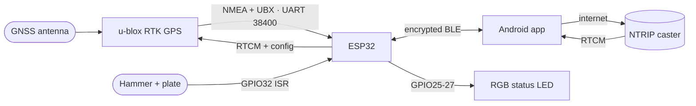
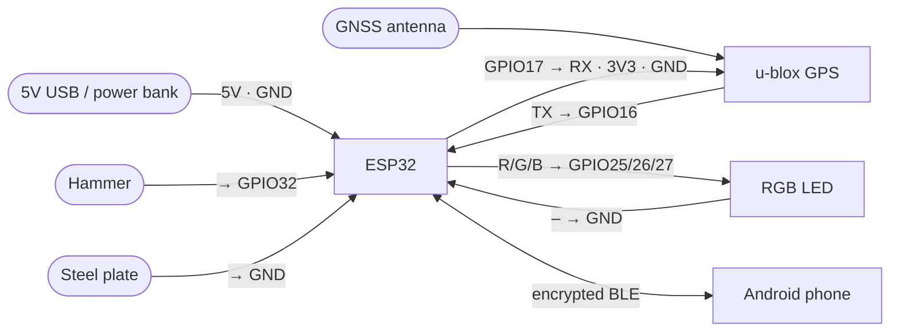

  

<h1 align="center">SmartSeismicSystem</h1>

<strong>Pinpoint the source. Own the future.</strong>

Centimeter-accurate RTK GPS + Up to nano second -precise seismic shot timing — on hardware and code built in-house.

  
  
  
  
  

---

## What it is

A field tool for **seismic surveys** — two parts that talk over Bluetooth:

> **RTK GPS gives the _where_. A hammer-strike trigger gives the _when_.**
> Together they geolocate every seismic shot to the **centimeter** and timestamp it to the **up to Nano second** — replacing bulky, expensive commercial gear with a phone + a matchbox-sized device.

- 🛰️ **`firmware/`** — ESP32 + u-blox RTK-GPS: centimeter positioning, a GPIO32 falling-edge ISR shot trigger with up to Nano second UBX-NAV-PVT timestamps, RTCM relay over **encrypted** BLE, LittleFS waypoint/shot storage.
- 📱 **`app/`** — Expo SDK 56 / React Native: BLE link, NTRIP correction relay, live Leaflet map, survey + averaging, the **Shots** tab, stakeout, QC, and CSV/photo export in ITM / EPSG.

## Features

| | |
|---|---|
| 🎯 **Centimeter RTK** | u-blox multi-band + NTRIP corrections relayed phone → device |
| ⏱️ **up to Nano second shots** | hammer/plate trigger → ISR → UBX-NAV-PVT timestamp |
| 📡 **Survey** | line/station numbering, 5-point averaging, retake |
| 🗺️ **Live map** | Leaflet / OSM, offline tile cache, waypoint + shot layers |
| 🧭 **Stakeout** | navigate to planned points |
| ✅ **QC** | duplicate / no-fix / accuracy / station-gap checks |
| 📤 **Export** | CSV (ITM / EPSG), KML, photos; raw NMEA log |
| 🔊 **Field UX** | voice prompts + shot / waypoint sounds |

## Architecture

**Wiring (ESP32):**

| Pin | To | Notes |
|---|---|---|
| `GPIO16` / `GPIO17` | GPS TX / RX | UART1, 38400 8N1 |
| `GPIO25` / `26` / `27` | RGB LED R / G / B | status |
| `GPIO32` | hammer (plate → GND) | `INPUT_PULLUP`, falling-edge = shot |

### How to wire it

## Roadmap

- 🚜 **"Waze" for vibroseis fleets** — live fleet map + turn-by-turn to every source point, fully offline.
- 🤖 **Autonomous source vehicles** — driver-assist → self-positioning at the source point.
- 📟 **The trigger in your pocket** — phone + matchbox device replacing commercial trigger boxes.

## Build & flash

- **App** — `build.ps1` builds on the build server and installs to the phone (MIUI-safe). Or grab the prebuilt APK from Releases.
- **Firmware** — PlatformIO (`pio run -t upload`), or flash `firmware.bin` from a release with esptool. BLE is encrypted — pair with the device passkey on first connect.

## Releases

Prebuilt **Android APK** + ESP32 **firmware.bin** are attached to each tagged release → [**v2.8.1**](../../releases/tag/v2.8.1).

---

Built by <b>Moshe Fridin</b> with <b>Claude</b>.

