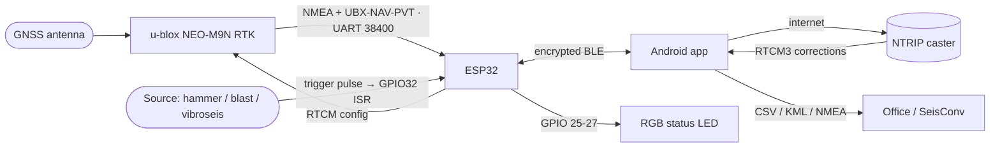

<p align="center">
  
</p>

<h1 align="center">SmartSeismicSystem</h1>
<p align="center"><strong>Pinpoint the source. Own the future.</strong></p>
<p align="center">
  One platform — centimeter RTK positioning, millisecond-precise shot timing, and a full desktop seismic data toolkit.
</p>

<p align="center">
  
  
  
  
  
  
  
</p>

---

## Overview

SmartSeismicSystem is a personal engineering project — three shippable products in one monorepo, covering the full seismic acquisition workflow from field hardware to desktop QC.

| Product | Layer | Ships as |
|---|---|---|
| [`firmware/`](firmware/) | Hardware — ESP32 trigger + RTK GPS | `firmware.bin` (PlatformIO / esptool) |
| [`app/`](app/) | Field — Android survey + trigger app | Android APK (self-signed) |
| [`seisconv/`](seisconv/) | Office — desktop seismic data toolkit | Windows NSIS installer; macOS DMG / Linux AppImage targets defined |

The firmware and app work together as the **field system**: the device fixes centimeter positions and captures millisecond shot times; the app is the control surface and data logger. SeisConv is the **office tool**: it reads, converts, inspects, and QC-checks seismic data files produced by acquisition systems — useful independently, not tightly coupled to the field hardware.

---

## Products

### firmware/ — ESP32 trigger device

The hardware layer. An ESP32 paired with a u-blox NEO-M9N RTK GPS module provides centimeter positioning and millisecond shot timing over encrypted BLE.

- GPIO32 falling-edge ISR captures the shot instant; timestamp comes from UBX-NAV-PVT (millisecond precision, nanosecond-resolution time base)
- Source-agnostic: fires on any contact closure — hammer/plate, weight-drop, explosive shot-break, vibroseis time-break/start-of-sweep
- BLE encrypted (Secure Connections + bonding); RTCM relay from phone to GPS chip
- LittleFS waypoint and shot storage; RGB status LED

**Status: working, field-tested hardware.**

See [firmware/README.md](firmware/README.md) for wiring, build, and flash instructions.

---

### app/ — Survey GPS (Android)

The field control surface. An Expo SDK 56 / React Native app that connects to the ESP32 over BLE and handles NTRIP correction relay, survey data recording, and export.

- RTK Fix quality 4 yields 1-2 cm horizontal accuracy (per u-blox NEO-M9N + `hdopToAccuracy()` logic)
- NTRIP 1.0 (ICY 200 OK) and 2.0 correction relay; credentials stored in the OS keystore
- Survey screen: line/station/step numbering, 5-point averaging, retake-last-N, accuracy filter
- Shots tab: GPIO32 trigger config (edge, debounce), shot list, CSV export, shot-plan import
- Live Leaflet / OpenStreetMap map: position + accuracy circle, per-line polylines, stakeout navigation
- QC: duplicate / no-fix / poor-accuracy / station-gap checks
- Export: CSV (ITM / EPSG), KML, photos, raw NMEA log; voice prompts and shot/waypoint sounds

**Status: working Android app, v2.8.1 (versionCode 281). Requires the ESP32 device.**

See [app/README.md](app/README.md) for build and install instructions.

<p align="center">
  
  &nbsp;
  
  &nbsp;
  
</p>
<p align="center"><sub>Survey numbering &amp; stakeout · shot-trigger config · device &amp; NTRIP caster setup</sub></p>

---

### seisconv/ — SeisConv desktop seismic toolkit

The office layer. A cross-platform Electron desktop app with a pure-TypeScript parsing core. Reads, converts, inspects, views, and QC-checks seismic data.

- **Formats:** SEG-Y Rev 0/1/2, SEG-D Rev 1/3, SEG-2 / Geode `.dat`, Seismic Unix (SU), tape image (`.tpimage`) — read; SEG-Y, SEG-2, SU, tape image, CSV — write; SEG-D write is experimental (not validated against vendor tools). Single-file or whole-folder batch conversion with a save wizard, live progress, and cancel
- **5-tab UI:** Converter, Trace Inspector (wiggle + FFT spectrum), File Viewer (variable-density / wiggle / variable-area, 4 colormaps, gain/AGC), SPS 2.1 (survey grid + real basemap, QC, EPSG reprojection export), Velocity (NMO semblance, pick + export CSV)
- Worker-thread architecture: large files never block the UI
- 50 core unit tests; real-data QC harness against a field file corpus

**Status: working desktop app. Windows NSIS installer (unsigned — Windows SmartScreen will warn on first run). macOS DMG and Linux AppImage targets are defined but not yet built or distributed.**

See [seisconv/README.md](seisconv/README.md) for full feature details, build instructions, and format notes.

<p align="center">
  
</p>
<p align="center"><sub>SeisConv — Converter (single-file &amp; folder-batch, with a save wizard and live progress)</sub></p>

---

## Repository structure

```
SmartSeismicSystem/
├── firmware/          ESP32 trigger + RTK GPS (C++ / Arduino / PlatformIO)
├── app/               Survey GPS Android app (Expo SDK 56 / React Native / TypeScript)
├── seisconv/          SeisConv desktop toolkit (Electron 33 + TypeScript)
└── docs/              Logo, social preview, and app screenshots
```

---

## System architecture



**ESP32 wiring:**

| Pin | Connected to | Notes |
|---|---|---|
| GPIO16 / GPIO17 | GPS TX / RX | UART1, 38400 8N1 |
| GPIO25 / 26 / 27 | RGB LED R / G / B | status indicator |
| GPIO32 | trigger input (contact to GND) | INPUT_PULLUP, falling-edge = shot |

---

## Quickstart

### Firmware

```bash
# requires PlatformIO
cd firmware
pio run -t upload
```

Or flash a prebuilt `firmware.bin` from [Releases](../../releases) with esptool:

```bash
esptool.py --chip esp32 write_flash 0x10000 firmware.bin
```

### App

```bash
# builds on the Linux build server via app/build.ps1
# prebuilt APK is attached to each tagged release
adb install SmartSeismicSurvey-v2.8.1.apk
```

See [app/README.md](app/README.md) for the full build pipeline.

### SeisConv

```bash
cd seisconv
npm install
npm test        # run the core unit tests (50)
npm start       # build and launch
npm run dist    # package an NSIS installer (Windows)
```

---

## Roadmap

**Near term**
- PPS input on GPIO for sub-millisecond shot timing (the u-blox time base is already nanosecond-resolution; a PPS wire is the only gap)
- Opto-isolated trigger inputs for compatibility with blaster fire / shot-break signals
- SEG-D write validation against Sercel / ION / Geospace acquisition tools

**Longer term**
- Multi-unit time sync across a spread on one GNSS time base
- "Waze for vibroseis fleets" — live fleet map with routing to source points and full offline operation
- Real-time field QC — flag bad or mis-positioned shots while the crew is still on site
- Recorder / SEG-Y hooks — feed precise shot times and cm positions straight into the processing chain

---

## Releases

Prebuilt **Android APK** and ESP32 **firmware.bin** are attached to each tagged release.
The **SeisConv Windows installer** is included from the first SeisConv release onward.

See [Releases](../../releases) for the latest.

---

## License

Copyright (c) 2026 Moshe Fridin. All rights reserved.
This repository is proprietary and confidential. See [LICENSE](LICENSE).

Third-party open-source dependencies remain under their own licenses; see Credits below.

---

## Credits

**Firmware**
- [TinyGPSPlus](https://github.com/mikalhart/TinyGPSPlus) — Mikal Hart, LGPL-2.1
- ESP32 Arduino core and bundled libraries (BLE, LittleFS, Preferences) — Espressif / Arduino, Apache-2.0 / LGPL-2.1

**App**
- React Native, Expo SDK 56 and modules, React Navigation — MIT
- react-native-ble-plx — Apache-2.0
- react-native-tcp-socket, react-native-webview, react-native-svg, gesture-handler, screens, safe-area-context, async-storage, jszip — MIT
- [Leaflet](https://leafletjs.com) — BSD-2-Clause; leaflet-rotate — MIT
- Map data: OpenStreetMap contributors — ODbL; used per the [OSM tile usage policy](https://operations.osmfoundation.org/policies/tiles/)

**SeisConv**
- Electron — MIT; electron-builder — MIT
- esbuild — MIT

---

<p align="center"><sub>Built by <b>Moshe Fridin</b> with <b>Claude</b>.</sub></p>
