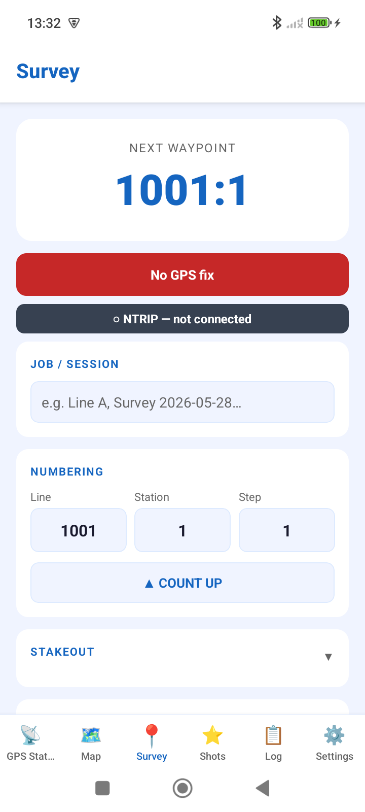
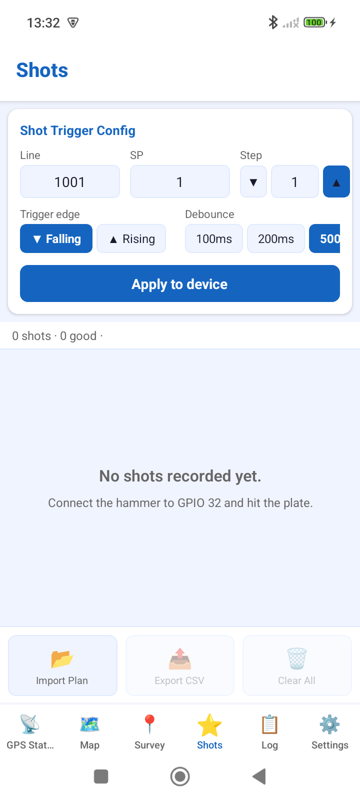
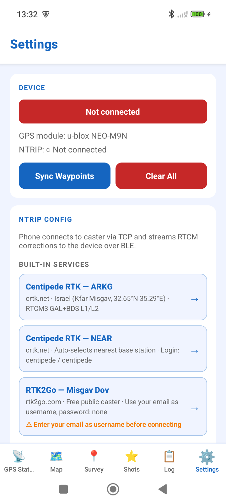

# Survey GPS — SmartSeismicSystem field app

<p align="center">
  
  &nbsp;
  
  &nbsp;
  
</p>
<p align="center"><sub>Survey + stakeout · shot-trigger config · device &amp; NTRIP setup</sub></p>

Android field app for the SmartSeismicSystem platform. Controls the ESP32 device over BLE, relays NTRIP RTK corrections, records survey waypoints and shot events, and exports field data.

Part of [SmartSeismicSystem](../README.md).

---

## Capabilities

### RTK positioning
- Connects to the ESP32 device over encrypted BLE (Secure Connections + bonding)
- Relays NTRIP RTCM3 corrections from phone to device (supports NTRIP 1.0 ICY 200 OK and 2.0 HTTP/x.x 200)
- RTK Fix quality 4 gives 1-2 cm horizontal accuracy (u-blox NEO-M9N + hdopToAccuracy() multipliers)
- Mountpoint-offline detection; 15-second reconnect timeout

### Survey screen
- Line / station / step numbering with configurable step size
- 5-point position averaging before saving a waypoint
- Retake-last-N: overwrite the most recent N waypoints
- Accuracy filter: only allow saving when horizontal accuracy is below a threshold

### Shots tab
- Configure GPIO32 trigger (edge polarity, debounce interval) and push config to the device over BLE
- Shot list with GPS timestamp (millisecond-precise via UBX-NAV-PVT), position, and accuracy
- CSV export; shot-plan import

### Map
- Leaflet / OpenStreetMap live map
- Live position with RTK accuracy circle
- Per-line polylines connecting saved waypoints
- Stakeout: navigate to a planned source or receiver point

### QC
- Duplicate waypoint IDs
- No-fix positions
- Poor-accuracy positions (above threshold)
- Station numbering gaps

### Export
- CSV with ITM or any EPSG coordinate system
- KML
- Photos attached to waypoints
- Raw NMEA log
- Activity log (JSONL, accessible via ADB)

### Field UX
- Voice prompts via expo-speech (waypoint saved, shot captured, accuracy warning)
- Shot and waypoint sounds via expo-audio
- NTRIP credentials stored in the OS keystore (expo-secure-store, not in the repo)

---

## Technical details

| Item | Value |
|---|---|
| Framework | Expo SDK 56 / React Native |
| Language | TypeScript |
| Package | `com.smartseismic.surveygps` |
| Version | 2.8.1 (versionCode 281) |
| Platform | Android |
| BLE library | react-native-ble-plx (Apache-2.0) |
| Map | Leaflet (BSD-2) + OpenStreetMap (ODbL) |

---

## Build

The app requires a Linux build server (Gradle / Android SDK). Build and install via PowerShell:

```powershell
# from the repo root, on Windows — runs the build on the server and installs
.\app\build.ps1
```

The build script compiles the APK on the server, pulls it locally, and installs it to a connected Android device.

The APK is self-signed (release keystore via Gradle, not distributed through Google Play or with a CA certificate). On first install, Android may require enabling installation from unknown sources. On MIUI / Xiaomi devices, the build script handles the MIUI-specific install prompt.

Prebuilt APKs are also attached to each [tagged release](../../releases).

---

## Firmware dependency

This app requires the matching ESP32 firmware from [`firmware/`](../firmware/README.md). Without the device, BLE connection and trigger functions are unavailable. RTK positioning requires a working NTRIP caster subscription and network access on the phone.

---

<p align="center"><sub>Part of <b>SmartSeismicSystem</b> — built by Moshe Fridin with Claude.</sub></p>
