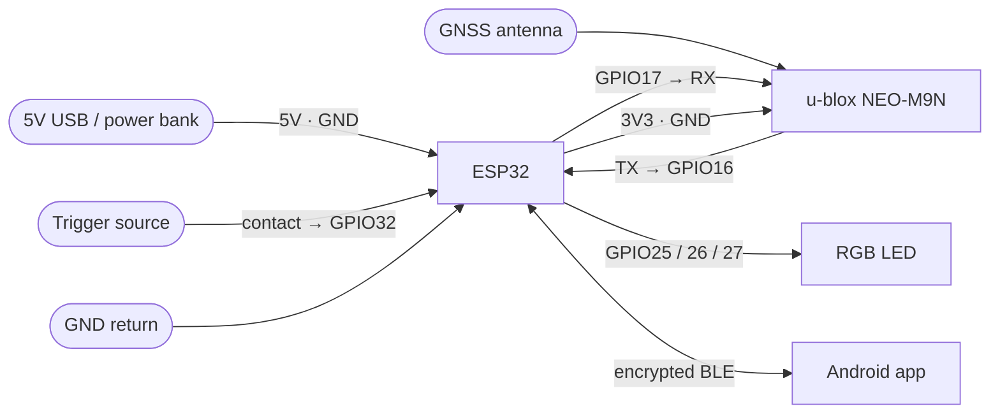

# Firmware — SmartSeismicSystem ESP32 trigger device

The hardware layer of the SmartSeismicSystem platform. An ESP32 paired with a u-blox NEO-M9N RTK GPS module provides centimeter-accurate positioning and millisecond-precise shot timing, connected to the Android field app over encrypted BLE.

Part of [SmartSeismicSystem](../README.md).

---

## What it does

- **RTK positioning:** u-blox NEO-M9N via UART1 (38400 8N1), parsing NMEA sentences and UBX-NAV-PVT binary messages for millisecond-precise GPS timestamps
- **Shot trigger:** GPIO32 falling-edge ISR captures the moment energy enters the ground; timestamp is taken from UBX-NAV-PVT (millisecond precision; the u-blox time base is nanosecond-resolution — a PPS wire would push accuracy further)
- **Source-agnostic:** the trigger fires on any contact closure or pulse — hammer/plate, weight-drop, explosive shot-break, vibroseis time-break or start-of-sweep
- **RTCM relay:** receives RTCM3 correction data from the Android app over BLE and forwards it to the GPS module
- **BLE encrypted:** Secure Connections + bonding (ESP_GAP_BLE_STATIC_PASSKEY_OPT); all GATT characteristics require encryption
- **Storage:** LittleFS on flash (append-only, flash-wear-safe); stores waypoints and shot records
- **Status LED:** RGB LED on GPIO25/26/27 signals GPS fix quality, BLE state, and shot events

---

## Hardware

| Component | Part |
|---|---|
| MCU | ESP32 (NodeMCU-32S or equivalent) |
| GPS | u-blox NEO-M9N (multi-band RTK) |
| Trigger input | Contact closure to GND on GPIO32 |
| Status | RGB LED (common cathode, GPIO25/26/27) |
| Power | 5V USB / power bank |

### Wiring

| ESP32 pin | Connected to | Notes |
|---|---|---|
| GPIO16 | GPS TX | UART1 RX, 38400 8N1 |
| GPIO17 | GPS RX | UART1 TX |
| 3V3 + GND | GPS VCC + GND | |
| GPIO25 | LED Red | via current-limiting resistor |
| GPIO26 | LED Green | via current-limiting resistor |
| GPIO27 | LED Blue | via current-limiting resistor |
| GPIO32 | Trigger input | INPUT_PULLUP; short to GND = shot |
| GND | Trigger return | |



**Trigger wiring by source type:**

| Source | Signal to GPIO32 | Return |
|---|---|---|
| Hammer / plate | Plate contact | GND |
| Weight-drop | Geophone contact on weight | GND |
| Explosive blaster | Shot-break or fire line | GND |
| Vibroseis | Time-break or start-of-sweep | GND |

---

## Build and flash

Requires [PlatformIO](https://platformio.org/) (VS Code extension or CLI).

```bash
cd firmware

# build and upload over USB
pio run -t upload

# upload the filesystem (LittleFS) separately if needed
pio run -t uploadfs

# monitor serial output
pio device monitor --baud 115200
```

Or flash a prebuilt `firmware.bin` from [Releases](../../releases) with esptool:

```bash
esptool.py --chip esp32 --port /dev/ttyUSB0 \
  write_flash 0x10000 firmware.bin
```

**PlatformIO configuration:** see [`platformio.ini`](platformio.ini). Board: `nodemcu-32s`; framework: `arduino`; filesystem: `littlefs`; partition scheme: `huge_app`.

---

## BLE pairing

On first connect, the Android app will prompt for a passkey. Enter the device passkey when requested. After bonding, subsequent connections are automatic.

The BLE stack uses Secure Connections with static passkey pairing (ESP_GAP_BLE_STATIC_PASSKEY_OPT). All GATT characteristics require an encrypted link.

---

## Status LED

| Color | Meaning |
|---|---|
| Blue (slow blink) | Advertising — waiting for BLE connection |
| Blue (solid) | BLE connected |
| Green | GPS Fix (RTK Float or Fixed) |
| Yellow | GPS position acquired, no RTK |
| Red | No GPS fix |
| White flash | Shot captured |

---

## Roadmap

- PPS input: wire the GPS PPS pin to the ESP32 to push shot timing from millisecond toward microsecond / nanosecond class
- Opto-isolated inputs for compatibility with industrial blaster fire / shot-break signals
- Multi-unit time synchronization across a receiver spread

---

## Resource usage

At the last build: flash ~39%, RAM ~23%.

---

<p align="center"><sub>Part of <b>SmartSeismicSystem</b> — built by Moshe Fridin with Claude.</sub></p>
