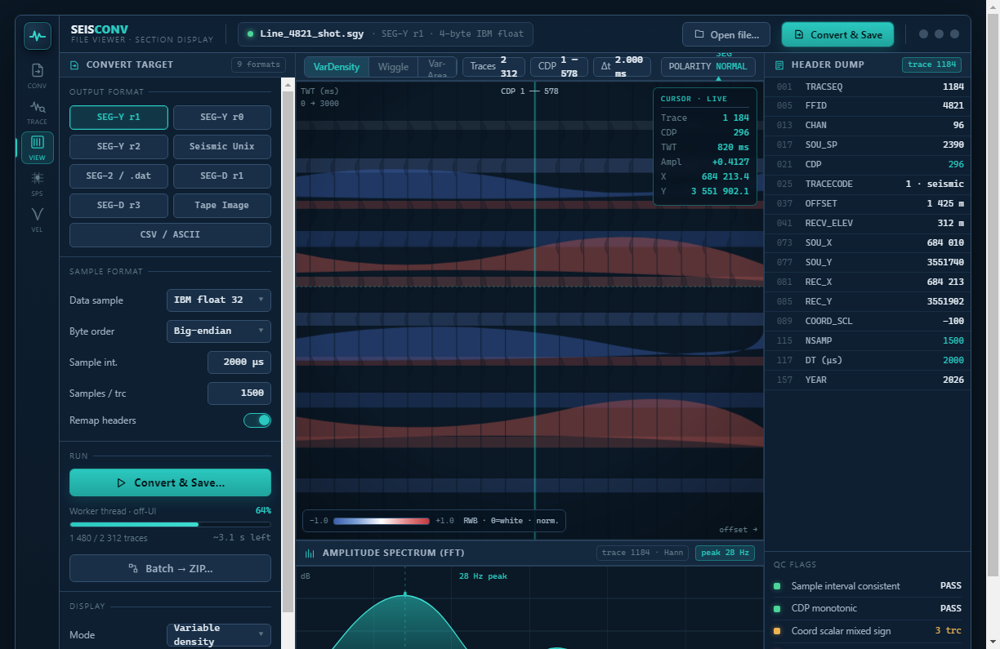
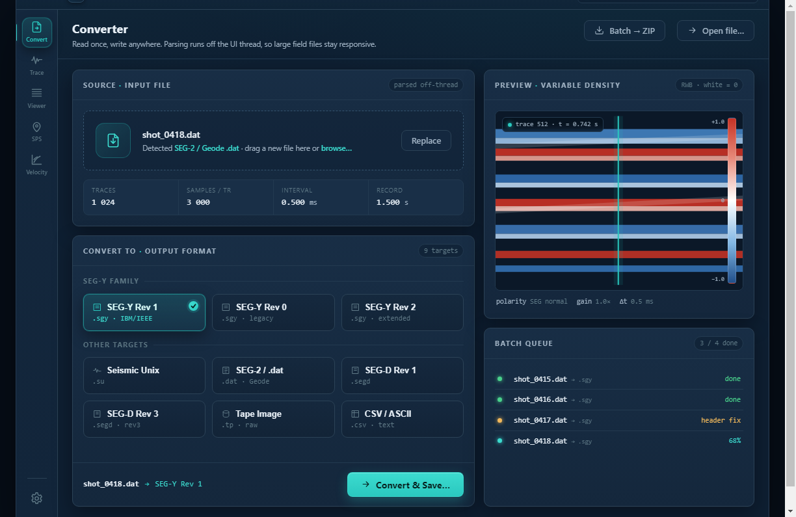

<p align="center">
  
</p>

<h1 align="center">SeisConv</h1>
<p align="center">
  Desktop seismic data toolkit — convert, inspect, view, and QC seismic files.<br/>
  Automatic format and byte-order detection. No configuration needed to open a file.
</p>

<p align="center">
  
  
  
  
  
</p>

Part of the [SmartSeismicSystem](../README.md) platform.

---

## What it does

SeisConv is a cross-platform Electron desktop application for working with seismic data files. Drop in any file and SeisConv identifies the format revision, sample encoding (IBM float vs IEEE), and byte order automatically — before you choose an output format. All parsing runs on a worker thread; the UI stays responsive on multi-gigabyte files.

Eight tabs cover the full office-side workflow: format conversion (Converter), per-trace inspection with FFT QC (Trace Inspector), section visualization (File Viewer), multi-format survey-geometry QC (SPS), NMO velocity analysis (Velocity), multi-trace comparison and correlation (Trace Workbench), configurable field-log grid (Observer's Log), and frequency/wavenumber analysis (Spectrum Analysis).

<p align="center">
  
</p>
<p align="center"><sub>Converter — auto-detected file summary, 9-format output picker, live batch progress</sub></p>

---

## Format support

| Format | Read | Write | Notes |
|---|:---:|:---:|---|
| SEG-Y Rev 0 | Yes | Yes | IBM float + IEEE float; EBCDIC / ASCII text header |
| SEG-Y Rev 1 | Yes | Yes | Extended text headers |
| SEG-Y Rev 2 | Yes | Yes | Rev 2.0 / 2.1; all rev-2 sample-format codes |
| SEG-D Rev 1 | Yes | (experimental) | Read validated on real field data; write not validated against vendor tools |
| SEG-D Rev 3 | Yes | (experimental) | Read validated on real field data; write not validated against vendor tools |
| SEG-2 / Geode `.dat` | Yes | Yes | |
| Seismic Unix (SU) | Yes | Yes | |
| Tape Image `.tpimage` | Yes | Yes | Wraps data in a single-file tape image; not validated against LTO/SCSI hardware |
| CSV | — | Yes | Export / analysis |

### Survey geometry / positioning formats

| Format | Read | Write | Notes |
|---|:---:|:---:|---|
| SEG-P1 | Yes | — | Deprecated by IOGP (succeeded by P1/11); read only by design. Fixed-column post-plot point file. Geographic records auto-projected lat/long → E/N; F-format metres vs integer-decimetres auto-detected. |
| IOGP P1/11 | Yes | Yes | Modern comma-delimited relational positioning standard (supersedes UKOOA P1/90 and SEG-P1; v1.1 added land/OBC). Source, receiver, and relation records map onto SeisConv's SPS data model; CRS round-trips. |
| IOGP P6/11 | Yes | — | Bin-grid definition (origin, rotation, inline/crossline numbering, bin size, CRS). Rendered as a bin-grid overlay on the SPS survey-grid and Leaflet map; rotation and crossline-axis aware. No writer yet. |
| Coordinate CSV (CRS-tagged) | Yes | Yes | Generic point CSV with an explicit CRS tag (ITM / UTM / WGS84) and flexible column-synonym mapping (line, point, type, easting/x, northing/y, elevation/z). |

**Automatic detection:** format revision, sample format (IBM 4-byte float, IEEE float, 2-byte int, etc.), and byte order (big/little-endian) are detected from the file header before conversion. No manual override required for well-formed files.

**Two conversion modes:** convert a **single file** (with a native save dialog), or point at a **folder** and batch-convert every seismic file in it — with a format/destination wizard, a live per-file progress bar, and a Cancel button.

---

## Features

### Converter

Two modes selected from the top of the tab.

**Single file:** open a file (`Ctrl+O` or drag-and-drop), review the auto-detected **File summary** (traces, samples per trace, sample interval, record length, data format, revision, byte order, CRS) and **Header QC** flags. Pick an output format chip from the nine available, then **Convert & Save...** via a native save dialog.

**Folder (batch):** pick a source folder — SeisConv lists every recognized seismic file. A short wizard asks for the output format and a destination folder, then runs the batch. A **live progress bar** tracks `Converting X / N · <filename> · FORMAT`. A per-file result list marks each file QUEUED → CONVERTING → DONE / ERROR. **Cancel** stops after the current file; completed files are kept.

Additional controls: **Clear** (reset state and worker cache), in-app **Manual** (Help / `?`), light/dark theme toggle, OS-aware keyboard shortcuts.

---

### Trace Inspector

Per-trace canvas wiggle with prev/next navigation buttons and a slider. Includes a **Hann-windowed FFT amplitude spectrum** panel — toggle between waveform and spectrum view for per-trace frequency QC.

<p align="center">
  
</p>
<p align="center"><sub>Trace Inspector — wiggle + FFT amplitude spectrum (Hann window)</sub></p>

---

### File Viewer

Full seismic section rendered in four display modes:

- Variable-density (heatmap)
- Wiggle trace
- Variable-area (filled wiggle)
- VD + wiggle overlay

Four colormaps: Seismic (blue-white-red), Gray, Amber, Viridis. Adjustable gain slider and automatic AGC. Section pan and zoom.

<p align="center">
  
</p>
<p align="center"><sub>File Viewer — variable-density section with colormap, gain, and AGC</sub></p>

---

### SPS

The SPS tab accepts SPS 2.1 S/R/X triplets and four additional positioning formats via the same Open dialog (`.p1`, `.segp1`, `.p111`, `.p611`, `.csv`): **SEG-P1** (read only — deprecated fixed-column post-plot file), **IOGP P1/11** (read + write — the current relational standard), **IOGP P6/11** (read only — bin-grid definition), and **CRS-tagged coordinate CSV** (read + write). All formats feed the same SPS data model, so the survey-grid, map, QC checks, fold map, and coordinate-reprojection features work identically regardless of which format was loaded. A format badge in the tab header indicates what is currently loaded.

**Header Viewer / Editor:** a modal over the SPS panel lets you view the full H-record block grouped by purpose (Project/Admin, CRS/Projection, and others), edit CRS and Admin fields via structured forms, and edit every raw H-record in a Raw tab. Changes can be applied and exported as a corrected ZIP containing the updated S/R/X files.

**Bin-grid overlay:** when an IOGP P6/11 file is loaded, the survey-grid canvas and the Leaflet real map display a bin-grid overlay (origin, rotation, and crossline-axis aware) on top of the station positions.

**Exports** (toolbar buttons):
- KML (Google Earth geometry overlay)
- GeoJSON (GIS-ready)
- CSV (sources, receivers, or relations)
- IOGP P1/11
- CRS-tagged coordinate CSV
- Full QC report

Load an SPS 2.1 survey (S-file, R-file, X-file). Two geometry views:

- **Survey grid** — offline pan/zoom canvas showing source (S) and receiver (R) stations, color-coded by type
- **Real map** — live Leaflet basemap (Dark / Satellite / Streets tile layers) with stations plotted at their geographic coordinates. A bearing slider (with reset-to-North button) rotates the map via the leaflet-rotate plugin.

**Station Inspector:** click any source or receiver to open a panel showing the full parsed SPS header for that station.

**X-ref spider:** select a station to draw offset lines to every related station in the X-file — shows the actual coverage geometry for that point.

**CMP fold/coverage map:** plots every CMP mid-point bin and colors it by fold count, giving a quick visual QC of coverage uniformity across the survey.

**QC checks** flag:
- Duplicate source / receiver IDs
- Station numbering gaps
- Irregular station intervals
- Missing X-file references
- Elevation outliers
- Offset range violations

**Coordinate reprojection:** transform any SPS dataset to a target EPSG (UTM zones, ITM, BNG, RD New, ED50, and others). Output is a ZIP with reprojected S/R/X files ready for import into processing software.

---

### Velocity

NMO semblance panel computed from CMP gathers in the loaded file. Click the semblance display to pick velocity-time pairs. Export the picked velocity function as a CSV for use in processing software.

---

### Trace Workbench

Collect traces from one file or many and view them side-by-side or overlaid on a shared time axis with synchronized zoom. Per-trace operations include cross-correlation and difference; a stats panel shows per-trace and aggregate amplitude statistics. Click-to-add works directly from the File Viewer section display and the Trace Inspector. The collected set can be exported as a seismic file (all supported output formats).

Manual X (time) and Y (amplitude) axis range boxes — with an Auto reset — control the shared display window.

---

### Observer's Log

A configurable field-log grid for recording shot-by-shot or point-by-point acquisition metadata. Column behavior is driven by a ROLE system: counter (auto-increment), Now/NTP time stamping, status dropdown (pick list), and SPS-linked cells that pull a named field (line, point, easting, northing, elevation, uphole, static, source type) from the loaded SPS survey with live per-row lookup. A Columns manager adds, removes, and reorders columns. Multiple templates can be saved in-app or shared as `.json` files. Source points can be imported from the loaded SPS survey. Exports to `.xlsx`, `.csv`, `.ods`, and a printable report — implemented without additional runtime dependencies.

---

### Spectrum Analysis

Three frequency-domain views of the loaded seismic data:

- **Average amplitude spectrum** — mean power across all traces, displayed in dB or linear scale, with peak-frequency and -6 dB bandwidth markers.
- **STFT spectrogram** — short-time Fourier transform of a single trace: a time × frequency heatmap showing how the spectrum evolves down the record.
- **F-K (2-D FFT)** — wavenumber × frequency panel for apparent-velocity, dip, and spatial-aliasing analysis.

All three views share the manual X/Y axis range boxes (with Auto reset) and support interactive wheel zoom and zoom-in / zoom-out buttons.

---

### Viewer controls

Every seismic viewer (File Viewer, Trace Inspector, Spectrum Analysis, Velocity, Trace Workbench) provides manual X-axis and Y-axis range boxes (min / max numeric inputs) plus an **Auto** button that clears the overrides and reverts to auto-fit. This makes it straightforward to compare the same time window across tabs or to zoom into a specific frequency band in the Spectrum views.

---

## Architecture

```
seisconv/
├── core/           Pure TypeScript engine — no Electron or DOM dependency
│   ├── binary/     Typed buffer readers (big/little-endian, IBM float)
│   ├── detect/     Format and byte-order auto-detection
│   ├── formats/    segy · segd · seg2 · su · tapeimage parsers + writers
│   ├── coords/     TM / UTM / ITM + Helmert 7-parameter transforms
│   ├── dsp/        AGC · interpolation · NMO semblance · Hann FFT ·
│   │               avgspectrum · spectrogram · fk · correlate
│   ├── render/     Colormaps and display model
│   ├── export/     xlsx · ods hand-rolled writers (no runtime deps)
│   └── sps/        SPS 2.1 parse · QC · reproject ·
│                   formats/ (segp1 · p111 · p611 · coordcsv + bingrid)
├── workers/
│   └── parse.worker.ts   Long-lived stateful worker: parses once, serves
│                         summary / trace / section / convert / SPS / semblance /
│                         spectrum / workbench requests via transferable ArrayBuffers
├── electron/
│   ├── main/       BrowserWindow, native dialogs, worker lifecycle
│   └── preload/    Sandboxed contextBridge (contextIsolation; no nodeIntegration;
│                   window navigation blocked; CSP default-src 'none')
└── renderer/       esbuild-bundled modular TypeScript UI (8-tab shell)
```

The `core/` package has no Electron or DOM imports — it can run in Node, a worker thread, or a browser.

---

## Build and run

Requires Node.js 18+ and npm.

```bash
cd seisconv
npm install             # install Electron and toolchain
npm run test:core       # run the 58 core unit tests (file-backed tests skip without sample data)
npm run typecheck       # TypeScript check (core + renderer + electron)
npm start               # build and launch the desktop app
npm run dist            # package an installer with electron-builder
```

**Test data:** most unit tests run with no external files. The file-backed format tests and the real-data QC harness read a local corpus — point them at your seismic files with:

```bash
SEISCONV_DATA=/path/to/segy-files \
SEISCONV_QC_ROOT=/path/to/corpus \
npx tsx scripts/realdata-qc.ts
```

---

## Installer

`npm run dist` produces:

- **Windows:** NSIS installer (`dist/*.exe`).
  _Not code-signed. Windows SmartScreen will warn on first run — click "More info" then "Run anyway"._
- **macOS:** DMG target defined; not currently built or distributed.
- **Linux:** AppImage target defined; not currently built or distributed.

---

## SEG standards note

SEG-Y and SEG-2 writers are validated for round-trip correctness against the bundled parsers and against real field data. SEG-D write produces a minimal layout that round-trips through the bundled reader, but it has **not** been validated for interchange with vendor acquisition software (Sercel SEAL, ION, Geospace). Do not use SeisConv-written SEG-D files as input to acquisition systems without independent verification.

---

## Roadmap

- SEG-D write validation against vendor acquisition tools (Sercel SEAL, ION, Geospace)
- SEG-D Rev 2 support
- Tape image multi-file support (current writer wraps one embedded file)

---

<p align="center"><sub>Part of <b>SmartSeismicSystem</b> — built by Moshe Fridin with Claude.</sub></p>
