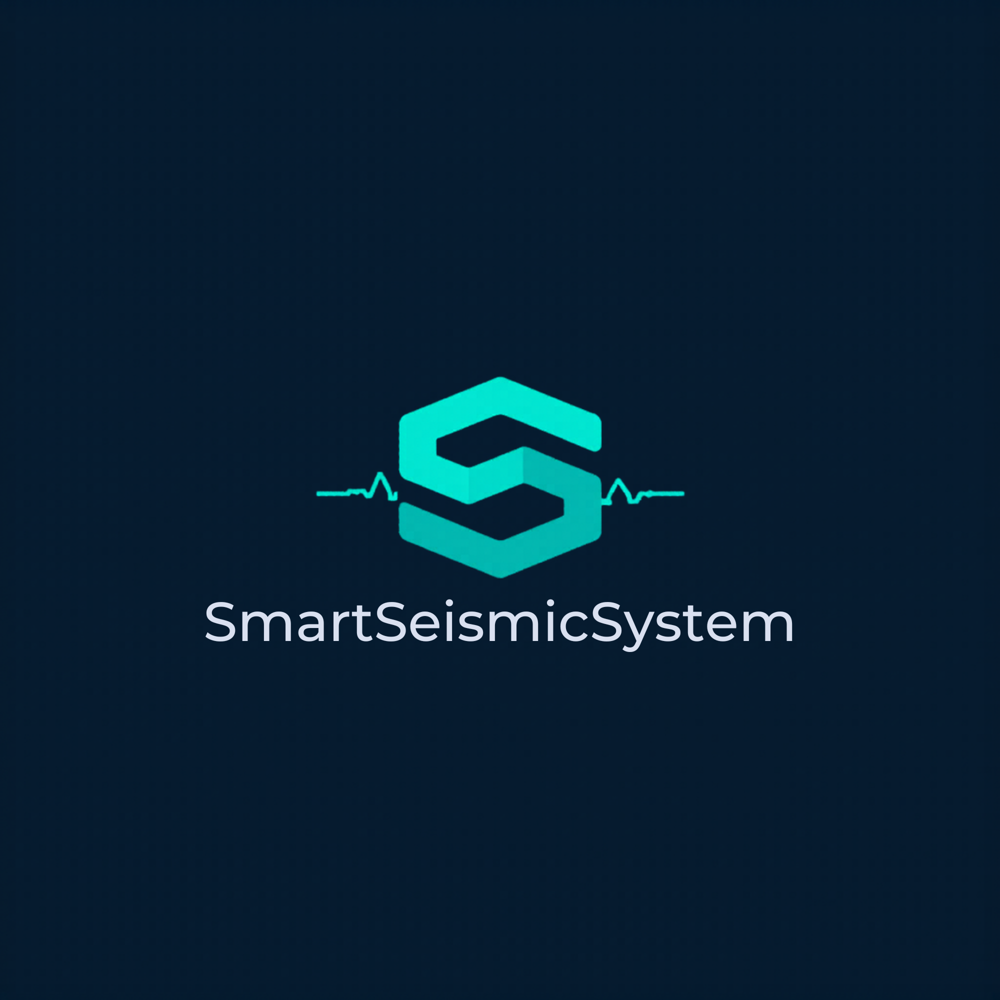
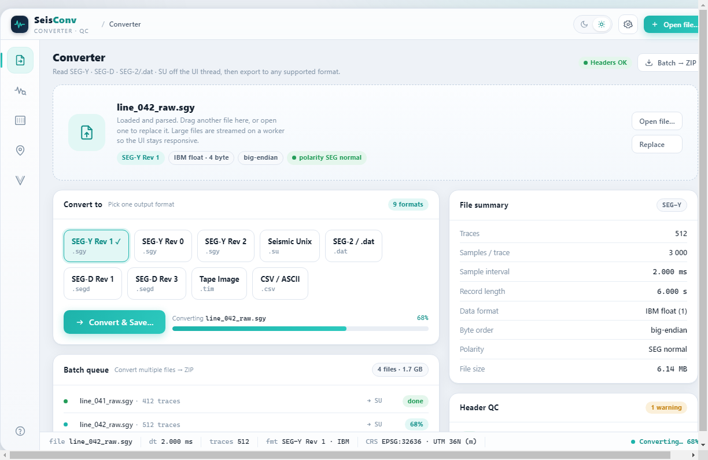

<p align="center">
  
</p>

<h1 align="center">SeisConv</h1>
<p align="center">Desktop seismic data toolkit — convert, inspect, view, and QC seismic files.</p>

<p align="center">
  
  
  
  
  
</p>

Part of the [SmartSeismicSystem](../README.md) platform.

---

## What it does

SeisConv is a cross-platform Electron desktop application for working with seismic data files. It handles the full office-side workflow: format conversion, trace-level inspection, section visualization, SPS survey QC, and velocity analysis. A pure-TypeScript parsing core runs on a worker thread — large files never block the UI.

<p align="center">
  
</p>
<p align="center"><sub>Converter — single-file &amp; folder-batch modes, with a save wizard and live progress</sub></p>

---

## Format support

| Format | Read | Write | Notes |
|---|:---:|:---:|---|
| SEG-Y Rev 0 | Yes | Yes | IBM float + IEEE float; EBCDIC / ASCII text header |
| SEG-Y Rev 1 | Yes | Yes | Extended text headers |
| SEG-Y Rev 2 | Yes | Yes | Rev 2.0 / 2.1; all rev-2 sample-format codes |
| SEG-D Rev 1 | Yes | (experimental) | Read validated against real field data; write is a minimal layout, not validated against Sercel / ION / Geospace tools |
| SEG-D Rev 3 | Yes | (experimental) | Read validated against real field data; write is a minimal layout, not validated against Sercel / ION / Geospace tools |
| SEG-2 / Geode `.dat` | Yes | Yes | |
| Seismic Unix (SU) | Yes | Yes | |
| Tape Image `.tpimage` | Yes | Yes | Wraps the data in a single-file tape image; not validated against LTO/SCSI hardware |
| CSV | — | Yes | Export / analysis |

**Two conversion modes:** convert a **single file** (with a save dialog), or point at a **folder** and batch-convert every seismic file in it to a chosen destination folder — with a format/destination wizard, a live per-file progress bar, and a cancel button.

---

## Features

### Converter tab
Two clear modes — **single file** or **folder (batch)**. *Single:* open a file, see its summary (format, traces, samples, sample interval, byte order, CRS) plus a header-QC check, pick an output format, and **Convert & Save…**. *Batch:* pick a folder, then a short wizard asks for the output format and a destination folder, and every seismic file converts with a **live progress bar** and a **Cancel** button. Output formats: SEG-Y Rev 0/1/2, SEG-D Rev 1/3 (experimental), SEG-2, SU, Tape Image, CSV. Also a **Clear** button (reset state), an in-app **manual** (Help), a light/dark theme toggle, and OS-aware keyboard shortcuts.

### Trace Inspector
Per-trace wiggle rendered on canvas. Navigate with prev/next buttons or a slider. Includes an **FFT amplitude spectrum** panel for per-trace frequency QC.

### File Viewer
Full seismic section display with four display modes:
- Variable-density (heatmap)
- Wiggle trace
- Variable-area (filled wiggle)
- VD + wiggle overlay

Four colormaps: seismic (blue-white-red), gray, amber, viridis. Adjustable gain and automatic AGC.

### SPS 2.1
Load S-file (sources), R-file (receivers), and X-file (relations). Two views: an offline **Survey grid** (pan/zoom/hover) and a live **Real map** basemap (Leaflet tiles — Dark / Satellite / Streets). QC checks flag:
- Duplicate source / receiver IDs
- Station numbering gaps
- Irregular station intervals
- Missing X-file references
- Elevation outliers
- Offset range violations

**Reprojection export:** transform coordinates to any EPSG target (UTM zones, ITM, BNG, RD New, ED50, and others) and export as a ZIP with reprojected S/R/X files.

### Velocity
NMO semblance panel computed from CMP gathers. Click to pick velocity-time pairs; export the velocity function as a CSV for processing.

---

## Architecture

```
seisconv/
├── core/           Pure TypeScript engine — no Electron or DOM dependency
│   ├── binary/     Typed buffer readers (big/little-endian, IBM float)
│   ├── detect/     Format auto-detection
│   ├── formats/    segy · segd · seg2 · su · tapeimage parsers + writers
│   ├── coords/     TM / UTM / ITM + Helmert 7-parameter transforms
│   ├── dsp/        AGC · interpolation · NMO semblance
│   ├── render/     Colormaps and display model
│   ├── sps/        SPS 2.1 parse · QC · reproject
│   └── __tests__/  50 unit tests (run with `npx tsx core/__tests__/run.ts`)
├── workers/
│   └── parse.worker.ts   Long-lived stateful worker: parses once, serves
│                         summary / trace / section / convert / SPS / semblance
│                         requests via transferable ArrayBuffers
├── electron/
│   ├── main/       BrowserWindow, native dialogs, worker lifecycle
│   └── preload/    Sandboxed contextBridge (contextIsolation; no nodeIntegration;
│                   window navigation blocked; CSP default-src 'none')
└── renderer/       esbuild-bundled modular TypeScript UI (5-tab shell)
```

The `core/` package has no Electron or DOM imports — it can run in Node, a worker thread, or a browser.

---

## Build and run

Requires Node.js 18+ and npm.

```bash
cd seisconv
npm install          # install Electron and toolchain
npm test             # run the core unit tests (50; file-backed ones skip without sample data)
npm run typecheck    # TypeScript check (core + renderer + electron)
npm start            # build and launch the desktop app
npm run dist         # package an installer with electron-builder
```

**Test data:** most unit tests run with no external files; the file-backed format tests and the real-data QC harness (`scripts/realdata-qc.ts`) read a local corpus — point them at your seismic files with:

```bash
SEISCONV_DATA=/path/to/segy-files \
SEISCONV_QC_ROOT=/path/to/corpus \
npx tsx scripts/realdata-qc.ts
```

**Build server:** heavy builds and installer packaging run on the Linux build server. See the SmartSeismicSystem [build pipeline notes](../app/README.md) for context.

---

## Installer

Run `npm run dist` to produce:

- **Windows:** NSIS installer (`dist/*.exe`) via electron-builder.
  _Note: the installer is not code-signed. Windows SmartScreen will warn on first run. Click "More info" then "Run anyway" to proceed._
- **macOS:** DMG target defined; not currently built or distributed.
- **Linux:** AppImage target defined; not currently built or distributed.

---

## SEG standards note

SeisConv's SEG-Y and SEG-2 writers are validated for round-trip correctness against the bundled parsers and against real field data. SEG-D write is experimental — the output is a minimal layout that round-trips through the bundled reader, but it has not been validated for interchange with vendor acquisition software (Sercel SEAL, ION, Geospace). Do not use SeisConv-written SEG-D files as input to acquisition systems without independent verification.

---

## Roadmap

- SEG-D write validation against vendor acquisition tools (Sercel SEAL, ION, Geospace)
- SEG-D Rev 2 support
- Tpimage multi-file tape image (current writer wraps one embedded file)

---

<p align="center"><sub>Part of <b>SmartSeismicSystem</b> — built by Moshe Fridin with Claude.</sub></p>
